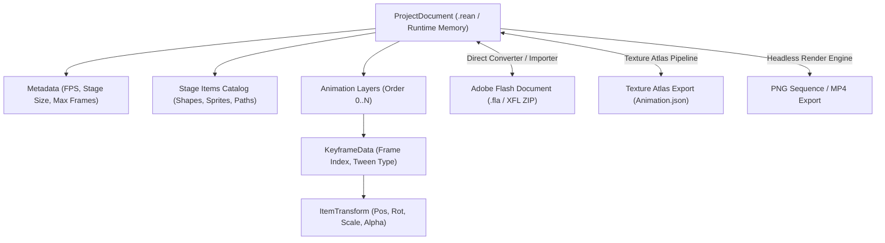

# 🗺️ REanimate - Project Roadmap & Architecture Plan

Dokumen roadmap dan spesifikasi arsitektur pengembangan **REanimate**, software authoring animasi 2D yang mereplikasi sistem, workflow, serta **UI & UX secara literal menyerupai Adobe Flash / Animate**, dibangun dengan **Godot Engine 4.7** untuk target distribusi **Windows Desktop** dan **Android Tablet/Mobile**.

---

## 📌 I. Visi & Lingkup Proyek (Scope)

Menciptakan software pembuat animasi 2D yang **secara literal mereplikasi estetika, tata letak, dan interaksi (UI/UX) Adobe Flash Professional / Animate**, dengan fokus pada:
1. **Literal Adobe Flash UI/UX**:
   - Skema warna Classic Charcoal/Slate Dark Theme resmi Adobe.
   - Penataan docking panel (Timeline di atas/bawah, Toolbar ikon vertikal 2-kolom khas Flash, Stage terpusat dengan pasteboard kelabu, Properties Inspector & Library di kanan).
   - Indikator visual timeline khas Flash: Keyframe bulat hitam/putih, blank keyframe berongga, panah Motion Tween biru/ungu, shape tween hijau muda, dan Playhead scrubber merah dengan garis pandu vertikal.
   - Muscle-memory keyboard shortcuts Flash (`V`, `A`, `Q`, `P`, `B`, `F5`, `F6`, `F7`, `F8`, `Enter`, `Ctrl+Enter`).
2. **Core Animation Engine**:
   - Timeline hierarkis multi-layer, frame span, interpolasi matriks transformasi 2D affine, dan hierarki nested symbols.
3. **Interoperabilitas Format Resmi Adobe**:
   - Format proyek mandiri (`.rean`).
   - Format runtime: **Adobe Animate Texture Atlas (`Animation.json` + `spritemap.json`)**.
   - Format mentah proyek resmi: **Adobe Flash/Animate Document (`.fla` / XFL zip archive)**.
4. **Distribusi Multiplatform**: Satu basis kode untuk Windows (`.exe`) dan Android Tablet/Phone (`.apk`).

---

## 🎨 II. Spesifikasi Literal UI & UX Adobe Flash / Animate

Tujuan fase ini adalah memastikan animator yang terbiasa menggunakan Flash CS6 / CC / Animate 2024 langsung merasa familier tanpa perlu adaptasi:

```
+------------------------------------------------------------------------------------------------------+
| [Menu Bar] File  Edit  View  Insert  Modify  Text  Commands  Control  Debug  Window  Help           |
+------+-------------------------------------------------------------------------------+---------------+
| Tool | [Timeline Panel - Flash Classic Layout]                                       | [Right Dock]  |
| Bar  | Layer 3  👁  🔒  [•───────>•] [Classic Tween (Biru)]                          |  Properties   |
| (2-  | Layer 2  👁  🔒  [○        ] [Blank Frame Span]                               |  - W, H, X, Y |
| Col) | Layer 1  👁  🔒  [•────────] [Hold Keyframe Span]                             |  - Color/Tint |
| [V][A|-------------------------------------------------------------------------------|  - Alpha, Loop|
| [Q][R| Frame: 1       30.0 fps       0.0s    |⏮  ◀  ▶  ⏭| [🔁] [🧅 Onion Skin]         |---------------+
| [B][P|===============================================================================|  Library      |
| [E][K|                                                                               |  - Symbol 1   |
| [C][S|                         [STAGE - White Canvas]                                |  - Symbol 2   |
|      |                                                                               |  - FeiLong.gif|
| [🎨] |                      +--------------------------+                             |               |
| [🪣] |                      |                          |                             |               |
|      |                      |       [Object Hero]      |                             |               |
| [🔍] |                      |                          |                             |               |
| [✋] |                      +--------------------------+                             |               |
|      |                                                                               |               |
+------+-------------------------------------------------------------------------------+---------------+
| [Bottom Info / Status Bar] 1280 x 720 | 100% Zoom | Selected: Symbol 2 | Scene 1                     |
+------------------------------------------------------------------------------------------------------+
```

### 1. Palet Warna & Visual Theme (Literal Flash):
- **Window Background**: `#262626` (Adobe Deep Charcoal).
- **Panel Header & Dock**: `#333333` dengan garis border `#1e1e1e`.
- **Stage Pasteboard (Area luar kanvas)**: `#404040` (Slate Gray) dengan bayangan gelap di sekeliling panggung putih.
- **Classic Motion Tween Span**: `#99CCFF` (Biru muda lembut) dengan panah hitam tipis solid di sepanjang durasi frame.
- **Shape Tween Span**: `#99FF99` (Hijau muda lembut).
- **Playhead Scrubber**: Kepala penunjuk segitiga/persegi merah terang `#E74C3C` dengan garis vertikal tembus pandang ke seluruh layer.

### 2. Standar Tombol & Muscle-Memory Shortcuts:
| Shortcut | Fungsi Flash Resmi | Replikasi di REanimate |
| :--- | :--- | :--- |
| **`V`** | Selection Tool (Panah Hitam) | Memilih, memindah, dan mengubah bentuk kurva |
| **`A`** | Subselection Tool (Panah Putih) | Mengedit titik anchor/node bezier |
| **`Q`** | Free Transform Tool | Bounding box 8 handle, titik pivot bulat, dan skew |
| **`P`** | Pen Tool | Menaruh titik anchor bezier vektor |
| **`B`** | Brush Tool | Menggambar sapuan kuas halus |
| **`F5`** | Insert Frame | Memperpanjang durasi frame (Hold Frame) |
| **`Shift + F5`** | Remove Frame | Memotong durasi frame |
| **`F6`** | Insert Keyframe | Merekam pose kunci baru (duplikasi dari frame sebelumnya) |
| **`F7`** | Insert Blank Keyframe | Membuat keyframe kosong bersih |
| **`Shift + F6`** | Clear Keyframe | Menghapus titik keyframe menjadi frame biasa |
| **`F8`** | Convert to Symbol | Membuka popup konversi ke Graphic / MovieClip |
| **`Enter`** | Play / Pause Preview | Menjalankan playhead di panggung |
| **`Ctrl + Enter`** | Test Movie | Menjalankan preview animasi di window baru |
| **`Space + Drag`** | Hand Tool (Pan Canvas) | Menggeser sudut pandang panggung |

---

## 🔬 III. Hasil Analisis File Proyek Flash Asli (`yellowman.fla`)

Struktur internal file `yellowman.fla`:
1. **Format Fisik**: File `.fla` merupakan **ZIP Archive berstandar XFL (XML Flash)** (`PK\x03\x04`).
2. **Manifes Dokumen (`DOMDocument.xml`)**:
   - Resolusi dokumen: `1280 x 720` pada `30 FPS`.
   - Mengatur guides, metadata, timeline utama, dan daftar symbols.
3. **Penyimpanan Simbol & Objek Vektor**:
   - Direktori `LIBRARY/` berisi 69 simbol terpisah.
   - Tag `<DOMShape>` menyimpan data kurva Bezier di string `edges` (`!` untuk koordinat awal, `|` untuk garis lurus, `[` untuk kurva kuadratik).
   - Tag `<DOMSymbolInstance>` mengatur penempatan simbol dengan matriks affine 2D `<Matrix tx="..." ty="..."/>`.

---

## 🏗️ IV. Arsitektur Data & Pemetaan Konsep



---

## 🧭 V. Roadmap Fase Pengembangan

```mermaid
flowchart LR
    Fase1["Fase 1: Core Engine Dasar"] --> Fase2["Fase 2: Stage & Timeline Interactive"]
    Fase2 --> Fase3["Fase 3: Multi-Layer & Properties"]
    Fase3 --> Fase4["Fase 4: Export & Serialization"]
    Fase4 --> Fase5["Fase 5: UI & UX Literal Flash Clone"]
    Fase5 --> Fase6["Fase 6: .FLA Import/Export Converter"]
    Fase6 --> Fase7["Fase 7: Android Tablet & Stylus Support"]
    Fase7 --> Fase8["Fase 8: Production Release & CI/CD"]
```



---

### **Fase 1: Core Engine & Data Model (SELESAI ✅)**
- [x] Inisialisasi arsitektur proyek Godot 4.7 (`gl_compatibility` renderer untuk Windows & Mobile).
- [x] Model data: `StageItem`, `ItemTransform`, `KeyframeData`, `AnimationLayer`, dan `ProjectDocument`.
- [x] Algoritma interpolasi sudut (`lerp_angle`), posisi, skala, dan transparansi (Motion Tweening).
- [x] Unit test otomatis (`test_suite.gd`) memvalidasi 5 pilar mesin dasar.

---

### **Fase 2: Stage Interactive & Timeline Grid (SELESAI ✅)**
- [x] Kanvas panggung (*Stage Paper*) terpusat simetris di titik `(0,0)` dengan efek drop-shadow dan outline.
- [x] Navigasi kamera profesional: Zoom wheel (0.2x–10.0x), Pan via Spacebar + Drag, reset view `Ctrl + 0`.
- [x] Seleksi objek dengan bounding box, pivot anchor, dan handle rotasi bebas.
- [x] Timeline Grid dengan ruler nomor frame, playhead merah, titik keyframe, dan rentang blok tweening biru.
- [x] Shortcuts: `Space` (Play/Pause), `F6` (Insert Keyframe), `F7` (Remove Keyframe), `Delete` (Hapus item).

---

### **Fase 3: Multi-Layer, Drawing & Properties Inspector (SELESAI ✅)**
- [x] Sistem Multi-Layer: Tambah/hapus layer, compositing multi-layer real-time.
- [x] Freehand Brush Tool (`B`): Menggambar bebas di atas stage dengan normalisasi titik.
- [x] Shape Creation Tools: Bentuk Kotak (`R`) dan Lingkaran (`O`).
- [x] Onion Skinning: Bayangan transparan 2 frame sebelum dan 2 frame sesudah frame aktif.
- [x] Properties Inspector: Input numerik untuk posisi, rotasi, skala, opacity, dan pemilih warna.

---

### **Fase 4: Serialization & Export Pipeline (SELESAI ✅)**
- [x] Format file proyek mandiri (`.rean`): Save, Open, New Project.
- [x] Ekspor format resmi **Adobe Animate Texture Atlas JSON** (`Animation.json` compatible) dengan matriks `M3D`.
- [x] Ekspor **PNG Image Sequence**: Render frame-by-frame otomatis ke folder.

---

### **Fase 5: UI & UX Literal Adobe Flash Clone (SEDANG BERJALAN / DITINGKATKAN 🎨)**
> **Target**: Menyempurnakan tampilan visual dan alur kerja agar 100% identik dengan Adobe Flash Professional / Animate.
- [x] Mode desktop native pixel-perfect (`stretch mode: disabled`).
- [ ] **Literal Flash Theme Styling**:
  - Terapkan Adobe Classic Slate/Charcoal palette theme ke seluruh panel dan tombol.
  - Pasteboard panggung berwarna abu-abu gelap khas Flash dengan border kanvas yang presisi.
- [ ] **Flash-Accurate Timeline Grid**:
  - Tampilan dot keyframe hitam solid untuk keyframe berobjek, lingkaran kosong untuk blank keyframe (`F7`).
  - Blok panah Motion Tween biru muda (`#99CCFF`) dengan garis panah kontinu dari keyframe awal ke akhir.
  - Tampilan strip layer dengan ikon mata (Hide/Show) dan gembok (Lock/Unlock) per-layer.
- [ ] **Vertical 2-Column Flash Toolbar**:
  - Desain ulang toolbar kiri menjadi tata letak 2 kolom vertikal dengan ikon khas Flash (Selection Arrow, Subselection, Free Transform, Lasso, Pen, Text, Line, Rect, Oval, Brush, Ink Bottle, Paint Bucket, Eyedropper, Eraser, Hand, Zoom).
  - Indikator warna Stroke & Fill berbentuk kotak tumpuk di bagian bawah toolbar.
- [ ] **Koleksi Shortcut Lengkap Flash**:
  - `F5` (Insert Hold Frame span).
  - `Shift + F5` (Remove Frame span).
  - `Shift + F6` (Clear Keyframe).
  - `Enter` untuk Play/Stop panggung & `Ctrl + Enter` untuk Test Movie window.
  - `F8` pop-up dialog "Convert to Symbol".

---

### **Fase 6: Kompatibilitas Dokumen .FLA (XFL Parser & Writer) (TERJADWAL 🎯)**
> **Target**: Membuka langsung file `.fla` buatan Adobe Flash / Animate asli (seperti `yellowman.fla`) dan menyimpannya kembali tanpa kehilangan data struktur.
- [ ] **Unzipper & DOMDocument Parser**:
  - Ekstrak file `.fla` in-memory menggunakan `ZIPReader` Godot bawaan.
  - Baca `DOMDocument.xml`: Ambil lebar/tinggi kanvas, frameRate, dan hierarki timeline utama (`<DOMLayer>`, `<DOMFrame>`, `<DOMSymbolInstance>`).
- [ ] **Library & Symbol Resolver**:
  - Parsing folder `LIBRARY/` untuk memetakan symbol Graphic / MovieClip bersarang.
- [ ] **Bezier Edge Parser**:
  - Menerjemahkan syntax kurva `<edges>` Adobe Flash (`!x y|x y[cx cy x y`) menjadi `PackedVector2Array` atau `Line2D` Godot.
- [ ] **FLA Export / Packaging**:
  - Mengemas proyek REanimate kembali ke format ZIP `.fla` yang dapat dibuka langsung di Adobe Animate Windows.

---

### **Fase 7: Android Tablet, Touch & Stylus Adaptation (BERIKUTNYA ⏳)**
> **Target**: Menjadikan REanimate nyaman dipakai di tablet Android menggunakan jari maupun Stylus (S-Pen, Active Pen) dengan tata letak adaptif Flash Mobile.
- [ ] Deteksi input sentuh multi-finger:
  - Pinch-to-zoom kanvas stage.
  - Two-finger pan & rotate canvas.
- [ ] Deteksi tekanan pen (*Stylus Pressure Sensitivity*) pada Brush Tool menggunakan event Godot input.
- [ ] Palm Rejection: Mengabaikan sentuhan telapak tangan saat ujung stylus menyentuh layar.
- [ ] Responsive Layout Switcher: Antarmuka otomatis beradaptasi antara mode Desktop (mouse/keyboard) dan mode Tablet (collapsible touch panels).
- [ ] Android Storage Access Framework (SAF) untuk menyimpan file `.rean` / `.fla` dan ekspor gambar ke internal storage.

---

### **Fase 8: Fitur Lanjutan & Produksi Rilis (MASA DEPAN 🚀)**
- [ ] **Symbol Converter UI (`F8`)**:
  - Dialog pop-up "Convert to Symbol" untuk mengubah objek terpilih menjadi Graphic / MovieClip dengan registrasi pivot point 9-titik.
- [ ] **Direct Video Encoding**:
  - Integrasi FFmpeg / WebM Movie Writer langsung dari aplikasi untuk menghasilkan MP4 / Animated GIF tanpa tool eksternal.
- [ ] **Audio Timeline Track**:
  - Menambahkan layer audio di timeline untuk sinkronisasi suara & dialog (*lip-sync*).
- [ ] **Packaging & Distribusi**:
  - Windows: Portable `.zip` dan installer `.exe`.
  - Android: Release `.apk` dan Google Play `.aab`.

---

## 🛠️ VI. Ringkasan File & Direktori Proyek

```
REanimate/
├── ROADMAP.md                        # Dokumen ini (spesifikasi & milestone)
├── README.md                         # Petunjuk penggunaan dan ringkasan fitur
├── project.godot                     # Konfigurasi engine Godot 4.7
├── screenshot_helper.gd              # Script capture visual UI
├── test_suite.gd                     # Unit test engine
└── src/
    ├── core/
    │   ├── stage_item.gd             # Model elemen stage (rect, circle, path, sprite)
    │   ├── item_transform.gd         # Model transformasi dan interpolasi lerp
    │   ├── keyframe_data.gd          # Model keyframe data
    │   ├── animation_layer.gd        # Model layer & multi-keyframe manager
    │   └── project_document.gd       # Root document, save/load .rean
    ├── export/
    │   └── export_manager.gd         # Texture Atlas JSON & PNG Sequence exporter
    └── ui/
        ├── stage_canvas.gd           # Canvas stage, hit-test, drawing, handles
        ├── timeline_grid.gd          # Visual timeline scrubber & keyframe blocks
        ├── editor_main.gd            # Controller logika antarmuka utama
        └── editor_main.tscn          # Scene layout UI utama
```
