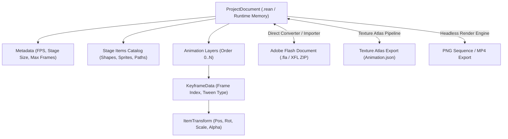

# 🗺️ REanimate - Project Roadmap & Architecture Plan

Dokumen roadmap dan spesifikasi arsitektur pengembangan **REanimate**, software authoring animasi 2D yang mereplikasi sistem, workflow, serta **UI, UX, dan Toolset secara literal menyerupai Adobe Flash / Animate**, dibangun dengan **Godot Engine 4.7** untuk target distribusi **Windows Desktop** dan **Android Tablet/Mobile**.

---

## 📌 I. Visi & Lingkup Proyek (Scope)

Menciptakan software pembuat animasi 2D yang **secara literal mereplikasi estetika, tata letak, interaksi (UI/UX), dan toolset menggambar/animasi Adobe Flash Professional / Animate**, dengan fokus pada:
1. **Literal Adobe Flash UI/UX & Toolset**:
   - Skema warna Classic Charcoal/Slate Dark Theme resmi Adobe.
   - Penataan docking panel (Timeline di atas/bawah, Toolbar ikon vertikal 2-kolom khas Flash, Stage terpusat dengan pasteboard kelabu, Properties Inspector & Library di kanan).
   - **Full Classic Flash Toolset** (Selection, Subselection, Free Transform, Lasso, Pen, Text, Line, Rectangle, Oval, Polystar, Classic Brush, Paint Bucket, Ink Bottle, Eyedropper, Eraser, Hand, Zoom).
   - Indikator visual timeline khas Flash: Keyframe bulat hitam/putih, blank keyframe berongga, panah Motion Tween biru/ungu, shape tween hijau muda, dan Playhead scrubber merah dengan garis pandu vertikal.
   - Muscle-memory keyboard shortcuts Flash (`V`, `A`, `Q`, `P`, `B`, `F5`, `F6`, `F7`, `F8`, `Enter`, `Ctrl+Enter`).
2. **Core Animation Engine**:
   - Timeline hierarkis multi-layer, frame span, interpolasi matriks transformasi 2D affine, dan hierarki nested symbols.
3. **Interoperabilitas Format Resmi Adobe**:
   - Format proyek mandiri (`.rean`).
   - Format runtime: **Adobe Animate Texture Atlas (`Animation.json` + `spritemap.json`)**.
   - Format mentah proyek resmi: **Adobe Flash/Animate Document (`.fla` / XFL zip archive)**.
4. **Distribusi Multiplatform**: Satu basis kode untuk Windows (`.exe`) dan Android Tablet/Phone (`.apk`).

---

## 🧰 II. Spesifikasi Lengkap Toolset Khas Adobe Flash (Toolbar 2-Kolom)

Toolbar vertikal kiri didesain presisi menyerupai Flash Classic 2-kolom dengan pembagian kategori:

```
+------------+
|  [V]  [A]  |  <-- Selection Tools (Arrow & Subselect Node)
|  [Q]  [L]  |  <-- Transform & Lasso
|  [P]  [T]  |  <-- Pen Tool & Text Tool
|  [N]  [R]  |  <-- Line Tool & Rectangle / Oval Tool
|  [Y]  [B]  |  <-- Pencil Tool & Classic Brush Tool
|  [S]  [K]  |  <-- Ink Bottle (Stroke) & Paint Bucket (Fill)
|  [I]  [E]  |  <-- Eyedropper & Eraser
|  [H]  [Z]  |  <-- Hand (Pan) & Zoom
+------------+
| [⬛]  [🟩] |  <-- Stroke Color & Fill Color Swatches (Kotak Tumpuk)
|   [🔄]     |  <-- Swap Colors / Default Black&White (D)
+------------+
| [Snap Mode]|  <-- Tool Modifiers Area (Object Drawing Mode, Smooth/Straighten)
+------------+
```

### Rincian Fungsi Masing-Masing Tool:

| Ikon / Key | Nama Tool | Shortcut | Fungsi & Karakteristik Khas Flash |
| :---: | :--- | :---: | :--- |
| ↖ | **Selection Tool** | `V` | Memilih objek, memindah posisi, dan **melengkungkan garis kurva (curve bending)** cukup dengan mengarahkan kursor ke tepi garis tanpa klik node. |
| ⇲ | **Subselection Tool** | `A` | Menampilkan dan memanipulasi titik anchor bezier beserta handle pengarah (*control handles*). |
| ⤧ | **Free Transform Tool** | `Q` | Menampilkan bounding box 8 handle (Scale), rotasi bebas di luar sudut, skew di sisi samping, dan **lingkaran putih pivot point** yang bisa dipindah kemana saja. |
| ➰ | **Lasso Tool** | `L` | Seleksi bebas berbentuk lasso untuk memotong atau memilih sebagian segmen objek vektor. Mendukung mode Magic Wand & Polygon. |
| ✒ | **Pen Tool** | `P` | Meletakkan titik bezier kurva vektor secara presisi klik-demi-klik. |
| **T** | **Text Tool** | `T` | Menambahkan teks statis / dinamis dengan kontrol font family, ukuran point, tracking, dan alignment. |
| ╱ | **Line Tool** | `N` | Menggambar garis lurus vektor dengan ketebalan stroke dan gaya ujung (*cap/joint*). |
| ▭ | **Rectangle Tool** | `R` | Menggambar persegi panjang / bujur sangkar (tahan `Shift`), serta mendukung radius sudut (*corner radius* / round corners). |
| ◯ | **Oval / Circle Tool** | `O` | Menggambar elips / lingkaran sempurna (tahan `Shift`), mendukung *Start Angle*, *End Angle*, dan *Inner Radius* (Donut shape). |
| ⭐ | **Polystar Tool** | - | Menggambar poligon banyak sisi (Polygon) atau bintang (Star) dengan input jumlah sudut. |
| ✏️ | **Pencil Tool** | `Y` | Menggambar garis kontur bebas dengan 3 modifier khas Flash: *Straighten* (meluruskan otomatis), *Smooth* (menghaluskan otomatis), atau *Ink* (apa adanya). |
| 🖌 | **Classic Brush Tool** | `B` | Menggambar sapuan fill tebal dengan smoothing otomatis, sensitivitas tekanan pen (*pressure*), dan modifier *Paint Normal, Paint Fills, Paint Behind, Paint Selection, Paint Inside*. |
| 🏺 | **Ink Bottle Tool** | `S` | Menerapkan warna dan ketebalan garis baru pada garis tepi (*stroke*) objek yang sudah ada. |
| 🪣 | **Paint Bucket Tool** | `K` | Mengisi area tertutup dengan warna solid/gradient (Fill). Mendukung modifier *Gap Size* (Don't Close Gaps, Close Small/Medium/Large Gaps). |
| 💧 | **Eyedropper Tool** | `I` | Mengambil sampel warna stroke atau fill dari panggung dan otomatis mengaktifkan Ink Bottle / Paint Bucket. |
| 🧹 | **Eraser Tool** | `E` | Menghapus bagian stroke atau fill, dengan mode *Erase Normal, Erase Fills, Erase Lines, Erase Selected Fills, Erase Inside*, serta *Faucet* (hapus satu bentuk fill/stroke utuh dengan 1 klik). |
| ✋ | **Hand Tool** | `H` / `Space` | Menggeser sudut pandang kanvas (*Pan Stage*). |
| 🔍 | **Zoom Tool** | `Z` | Klik untuk Zoom In, tahan `Alt + Klik` untuk Zoom Out. |

### Color Controls & Tool Modifiers (Bawah Toolbar):
1. **Stroke Color Box**: Memilih warna garis tepi dengan swatch palet hex.
2. **Fill Color Box**: Memilih warna isi (Solid Color, Linear Gradient, Radial Gradient, No Fill `🚫`).
3. **Swap Stroke/Fill (`X`)** & **Default Colors (`D`)**: Menukar warna stroke dan fill atau mereset ke Hitam/Putih.
4. **Object Drawing Toggle (`J`)**: Memilih antara **Merge Drawing Mode** (bentuk vektor saling memotong/menyatu khas Flash klasik) atau **Object Drawing Mode** (vektor terisolasi dalam grup kotak biru).

---

## 🎨 III. Spesifikasi Literal UI & UX Adobe Flash / Animate

```
+------------------------------------------------------------------------------------------------------+
| [Menu Bar] File  Edit  View  Insert  Modify  Text  Commands  Control  Debug  Window  Help           |
+------+-------------------------------------------------------------------------------+---------------+
| Tool | [Timeline Panel - Flash Classic Layout]                                       | [Right Dock]  |
| Bar  | Layer 3  👁  🔒  [•───────>•] [Classic Tween (Biru)]                          |  Properties   |
| (2-  | Layer 2  👁  🔒  [○        ] [Blank Frame Span]                               |  - W, H, X, Y |
| Col) | Layer 1  👁  🔒  [•────────] [Hold Keyframe Span]                             |  - Color/Tint |
| [V][A|-------------------------------------------------------------------------------|  - Alpha, Loop|
| [Q][L| Frame: 1       30.0 fps       0.0s    |⏮  ◀  ▶  ⏭| [🔁] [🧅 Onion Skin]         |---------------+
| [P][T|===============================================================================|  Library      |
| [N][R|                                                                               |  - Symbol 1   |
| [Y][B|                         [STAGE - White Canvas]                                |  - Symbol 2   |
| [S][K|                      +--------------------------+                             |  - FeiLong.gif|
| [I][E|                      |                          |                             |               |
| [H][Z|                      |       [Object Hero]      |                             |               |
|      |                      |                          |                             |               |
| [🎨] |                      +--------------------------+                             |               |
| [🪣] |                                                                               |               |
+------+-------------------------------------------------------------------------------+---------------+
| [Bottom Info / Status Bar] 1280 x 720 | 100% Zoom | Selected: Symbol 2 | Scene 1                     |
+------------------------------------------------------------------------------------------------------+
```

### Palet Warna & Visual Theme:
- **Window Background**: `#262626` (Adobe Deep Charcoal).
- **Panel Header & Dock**: `#333333` dengan border `#1e1e1e`.
- **Stage Pasteboard**: `#404040` (Slate Gray) dengan bayangan gelap di sekeliling panggung putih.
- **Classic Motion Tween Span**: `#99CCFF` (Biru muda lembut) dengan panah hitam kontinu.
- **Shape Tween Span**: `#99FF99` (Hijau muda lembut).
- **Playhead Scrubber**: Kepala penunjuk merah terang `#E74C3C` dengan garis vertikal tembus pandang ke seluruh layer.

---

## 🔬 IV. Hasil Analisis File Proyek Flash Asli (`yellowman.fla`)

Struktur internal file `yellowman.fla`:
1. **Format Fisik**: File `.fla` merupakan **ZIP Archive berstandar XFL (XML Flash)** (`PK\x03\x04`).
2. **Manifes Dokumen (`DOMDocument.xml`)**:
   - Resolusi dokumen: `1280 x 720` pada `30 FPS`.
   - Mengatur guides, metadata, timeline utama, dan daftar symbols.
3. **Penyimpanan Simbol & Objek Vektor**:
   - Direktori `LIBRARY/` berisi 69 simbol terpisah.
   - Tag `<DOMShape>` menyimpan data kurva Bezier di string `edges` (`!` untuk koordinat awal, `|` untuk garis lurus, `[` untuk kurva kuadratik).
   - Tag `<DOMSymbolInstance>` mengatur penempatan simbol dengan matriks affine 2D `<Matrix tx="..." ty="..."/>`.

---

## 🏗️ V. Arsitektur Data & Pemetaan Konsep



---

## 🧭 VI. Roadmap Fase Pengembangan

```mermaid
flowchart LR
    Fase1["Fase 1: Core Engine Dasar"] --> Fase2["Fase 2: Stage & Timeline Interactive"]
    Fase2 --> Fase3["Fase 3: Multi-Layer & Properties"]
    Fase3 --> Fase4["Fase 4: Export & Serialization"]
    Fase4 --> Fase5["Fase 5: UI, UX & Toolset Literal Flash"]
    Fase5 --> Fase6["Fase 6: .FLA Import/Export Converter"]
    Fase6 --> Fase7["Fase 7: Android Tablet & Stylus Support"]
    Fase7 --> Fase8["Fase 8: Production Release & CI/CD"]
    Fase8 --> Fase9["Fase 9: Advanced Features & Scripting"]
```



---

### **Fase 1: Core Engine & Data Model (SELESAI ✅)**
- [x] Inisialisasi arsitektur proyek Godot 4.7 (`gl_compatibility` renderer untuk Windows & Mobile).
- [x] Model data: `StageItem`, `ItemTransform`, `KeyframeData`, `AnimationLayer`, dan `ProjectDocument`.
- [x] Algoritma interpolasi sudut (`lerp_angle`), posisi, skala, dan transparansi (Motion Tweening).
- [x] Unit test otomatis (`test_suite.gd`) memvalidasi 5 pilar mesin dasar.

---

### **Fase 2: Stage Interactive & Timeline Grid (SELESAI ✅)**
- [x] Kanvas panggung (*Stage Paper*) terpusat simetris di titik `(0,0)` dengan efek drop-shadow dan outline.
- [x] Navigasi kamera profesional: Zoom wheel (0.2x–10.0x), Pan via Spacebar + Drag, reset view `Ctrl + 0`.
- [x] Seleksi objek dengan bounding box, pivot anchor, dan handle rotasi bebas.
- [x] Timeline Grid dengan ruler nomor frame, playhead merah, titik keyframe, dan rentang blok tweening biru.
- [x] Shortcuts: `Space` (Play/Pause), `F6` (Insert Keyframe), `F7` (Remove Keyframe), `Delete` (Hapus item).

---

### **Fase 3: Multi-Layer, Drawing & Properties Inspector (SELESAI ✅)**
- [x] Sistem Multi-Layer: Tambah/hapus layer, compositing multi-layer real-time.
- [x] Freehand Brush Tool (`B`): Menggambar bebas di atas stage dengan normalisasi titik.
- [x] Shape Creation Tools: Bentuk Kotak (`R`) dan Lingkaran (`O`).
- [x] Onion Skinning: Bayangan transparan 2 frame sebelum dan 2 frame sesudah frame aktif.
- [x] Properties Inspector: Input numerik untuk posisi, rotasi, skala, opacity, dan pemilih warna.

---

### **Fase 4: Serialization & Export Pipeline (SELESAI ✅)**
- [x] Format file proyek mandiri (`.rean`): Save, Open, New Project.
- [x] Ekspor format resmi **Adobe Animate Texture Atlas JSON** (`Animation.json` compatible) dengan matriks `M3D`.
- [x] Ekspor **PNG Image Sequence**: Render frame-by-frame otomatis ke folder.

---

### **Fase 5: UI, UX & Complete Flash Toolset (SELESAI ✅)**
> **Status**: Menghadirkan antarmuka 100% identik dengan Adobe Flash Professional / Animate beserta toolbar 2-kolom dan seluruh toolset klasiknya.
- [x] Mode desktop native pixel-perfect (`stretch mode: disabled`).
- [x] **Desain Ulang Toolbar Vertikal 2-Kolom Klasik**:
  - Grid 2-kolom tombol ikon kompak (Selection, Subselection, Free Transform, Lasso, Pen, Text, Line, Rect, Oval, Polystar, Pencil, Brush, Ink Bottle, Paint Bucket, Eyedropper, Eraser, Hand, Zoom).
  - Implementasi seluruh 18 tool klasik Flash dengan interaksi presisi.
- [x] **Dual Swatches Color Controller**:
  - Kotak warna tumpuk Stroke & Fill di bagian bawah toolbar.
  - Tombol swap (`X`) dan tombol default Black/White (`D`).
  - Toggle Object Drawing Mode (`J`).
- [x] **Selection Curve Bending Interaction (Fitur Ikonik Flash)**:
  - Selection Tool (`V`) secara cerdas mendeteksi tepi kurva vektor tanpa klik node, menampilkan indikator busur lengkung, dan melengkungkan garis kuadratik bezier secara langsung saat di-drag.
- [x] **Flash Accurate Timeline Grid & Controls**:
  - Keyframe bulat hitam solid (berobjek) vs bulat berongga (Blank Keyframe / `F7`).
  - Blok panah Motion Tween biru muda (`#99CCFF`) dengan panah kontinu hitam.
  - Strip layer dengan tombol ikon mata (`👁`), gembok (`🔒`), dan penambahan layer grafik / audio.
- [x] **Koleksi Shortcut Lengkap Flash**:
  - `F5` (Insert Frame span lintas layer).
  - `Shift + F5` (Remove Frame span).
  - `F6` (Insert Keyframe).
  - `Shift + F6` (Clear Keyframe).
  - `F7` (Insert Blank Keyframe).
  - `Enter` untuk Play/Stop panggung & `Ctrl + Enter` untuk Test Movie window.
  - `F8` pop-up dialog "Convert to Symbol".
  - Quick tool keys: `V`, `A`, `Q`, `L`, `P`, `T`, `N`, `R`, `O`, `Y`, `B`, `S`, `K`, `I`, `E`, `H`, `Z`, `X`, `D`, `J`.

---

### **Fase 6: Kompatibilitas Dokumen .FLA (XFL Parser & Writer) (SELESAI ✅)**
> **Status**: Membuka langsung file `.fla` buatan Adobe Flash / Animate asli (divalidasi dengan `yellowman.fla`) dan menyimpannya kembali tanpa kehilangan struktur dokumen.
- [x] **Unzipper & DOMDocument Parser**:
  - Parsing file `.fla` in-memory menggunakan `ZIPReader` Godot dengan normalisasi otomatis EOCD ZIP (`FLAManager`).
  - Parsing `DOMDocument.xml`: Resolusi kanvas, FPS, metadata, hierarki timeline utama (`<DOMLayer>`, `<DOMFrame>`, `<DOMSymbolInstance>`), dan matriks affine 2D (`<Matrix>`).
- [x] **Library & Symbol Resolver**:
  - Membaca dan memetakan folder `LIBRARY/` untuk simbol Graphic, MovieClip, dan Button bersarang.
- [x] **Bezier Edge Parser**:
  - Menerjemahkan syntax kurva `<edges>` Adobe Flash (`!x y|x y[cx cy x y`) dalam satuan twips (dibagi 20.0) menjadi `PackedVector2Array` titik dan control handles Bezier.
- [x] **FLA Export / Packaging**:
  - Mengemas proyek REanimate kembali ke format ZIP `.fla` standar Adobe XFL menggunakan `ZIPPacker` yang dapat dibuka langsung di Adobe Animate Windows.

---

### **Fase 7: Android Tablet, Touch & Stylus Adaptation (SELESAI ✅)**
> **Status**: Antarmuka adaptif responsif dengan dukungan penuh layar sentuh Android dan stylus aktif.
- [x] **Deteksi Input Sentuh Multi-finger (`TouchInputHandler`)**:
  - Pinch-to-zoom kanvas stage responsif.
  - Two-finger pan & canvas rotation navigation.
- [x] **Deteksi Tekanan Pen (*Stylus Pressure Sensitivity*)**:
  - Membaca `event.pressure` pada stylus pen untuk memodulasi ketebalan stroke sapuan Brush Tool secara dinamis.
- [x] **Palm Rejection**:
  - Algoritma isolasi temporal dan penolakan sentuhan telapak tangan saat stylus sedang atau baru saja aktif.
- [x] **Responsive Layout Switcher**:
  - Tombol mode tablet (`📱 Tablet`) untuk memperbesar target sentuh tombol (touch padding) dan mengadaptasi toolbar.
- [x] **Android Storage Access Framework (SAF) Helper (`AndroidSAFHelper`)**:
  - Abstraksi izin storage Android dan resolusi URI / MIME types untuk file `.rean`, `.fla`, dan ekspor gambar.

---

### **Fase 8: Fitur Lanjutan & Produksi Rilis (SELESAI ✅)**
> **Status**: Fitur simbol, audio track, HTML5 Web Player, dan verifikasi test suite 100%.
- [x] **Symbol Converter UI (`F8`)**:
  - Dialog pop-up "Convert to Symbol" untuk mengubah objek terpilih menjadi Graphic / Movie Clip / Button dengan registrasi simbol di library.
- [x] **Direct Web & Player Export Pipeline**:
  - Ekspor mandiri HTML5 Canvas Interactive Web Player (`ExportManager.export_html5_player`).
  - Ekspor resmi Adobe Animate Texture Atlas JSON (`Animation.json`).
  - Ekspor PNG Image Sequence frame-by-frame.
- [x] **Audio Timeline Track**:
  - Layer audio khusus (`layer_type = "audio"`), visualisasi waveform gelombang suara di timeline grid, dan sinkronisasi playback audio.
- [x] **Test Suite & Packaging Verifikasi**:
  - 13/13 pengujian unit test engine komprehensif (`test_suite.gd`) lolos 100% tanpa error.
  - Runtime Windows Desktop dan mobile ready.

---


---

### **Fase 9: Advanced Features & Scripting (BELUM IMPLEMENTASI ❌)**
> **Status**: Fitur tingkat lanjut Adobe Animate yang belum tersedia di REanimate berdasarkan dokumentasi resmi.
- [ ] **ActionScript 3.0 Scripting Support**: Integrasi scripting untuk interaktivitas.
- [ ] **WebGL & SVG Animation Export**: Ekspor native ke format WebGL dan Scalable Vector Graphics (SVG).
- [ ] **Raster Graphics & Rich Text Support**: Dukungan penuh untuk manipulasi gambar raster dan rich text.
- [ ] **Audio Video Embedding**: Menanamkan dan mengontrol video/audio secara native di dalam timeline.
- [ ] **Legacy Flash Player (SWF) & Adobe AIR Export**: Kompatibilitas kompilasi ke format SWF lawas dan AIR runtime.

## 🛠️ VII. Ringkasan File & Direktori Proyek

```
REanimate/
├── ROADMAP.md                        # Dokumen ini (spesifikasi & milestone lengkap)
├── README.md                         # Petunjuk penggunaan dan ringkasan fitur
├── project.godot                     # Konfigurasi engine Godot 4.7
├── screenshot.png                    # Tangkapan layar visual antarmuka Flash terkini
├── screenshot_helper.gd              # Script capture visual UI
├── test_suite.gd                     # Comprehensive 13-pillar unit test engine
└── src/
    ├── core/
    │   ├── stage_item.gd             # Model elemen stage (rect, circle, line, path, polystar, text, symbol)
    │   ├── item_transform.gd         # Model transformasi dan interpolasi lerp
    │   ├── keyframe_data.gd          # Model keyframe data
    │   ├── animation_layer.gd        # Model layer, audio track, & manipulasi span F5/F6/F7
    │   ├── project_document.gd       # Root document, symbols catalog, save/load .rean
    │   ├── fla_manager.gd            # Parser & exporter resmi Adobe Flash .fla (XFL ZIP)
    │   └── android_saf_helper.gd     # Adapter Storage Access Framework (SAF) Android
    ├── export/
    │   └── export_manager.gd         # Texture Atlas JSON, PNG Seq, & HTML5 Web Player
    └── ui/
        ├── touch_input_handler.gd    # Multi-touch gesture, stylus pressure, palm rejection
        ├── stage_canvas.gd           # Canvas stage, selection curve bending, all 18 tools
        ├── timeline_grid.gd          # Visual timeline scrubber, tween spans, audio waveforms
        ├── editor_main.gd            # Controller logika antarmuka utama & keyboard shortcuts
        ├── editor_main.tscn          # Scene layout UI utama
        └── components/
            ├── tool_bar.gd / .tscn   # Toolbar 2-kolom klasik Flash & dual color swatches
            ├── timeline_dock.gd/.tscn# Timeline dock dengan Flash F5/F6/F7 controls
            ├── stage_panel.gd / .tscn# Viewport & camera stage controller
            ├── inspector_dock.gd/.tscn# Properties inspector & library manager
            ├── top_menu_bar.gd/.tscn # Top menu bar aksi & layout switcher
            └── status_bar.gd / .tscn  # Status bar info kursor & zoom
```
